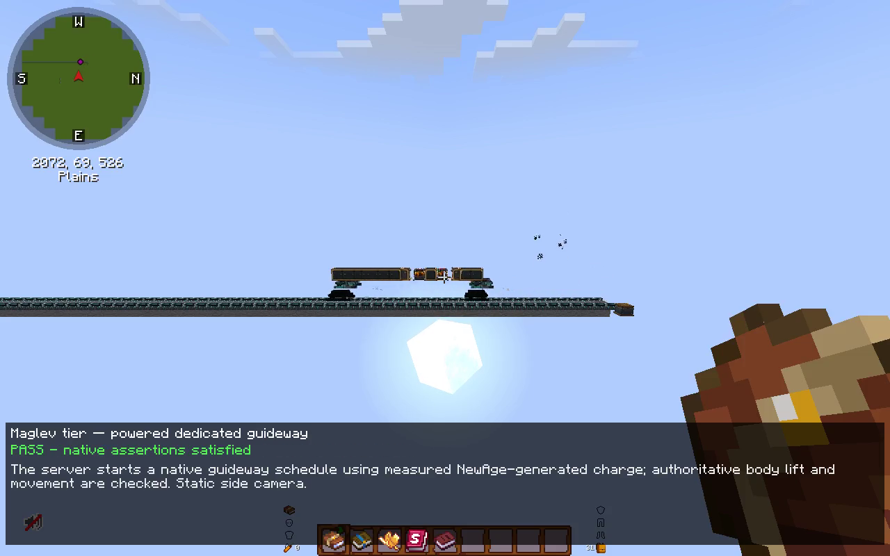
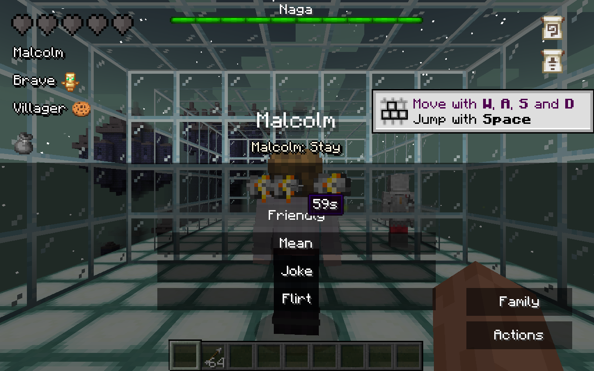
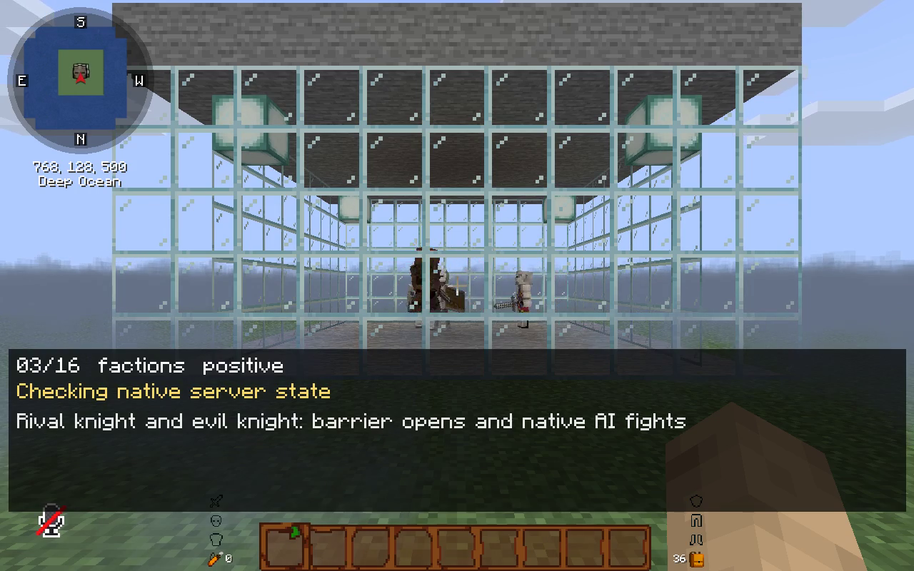
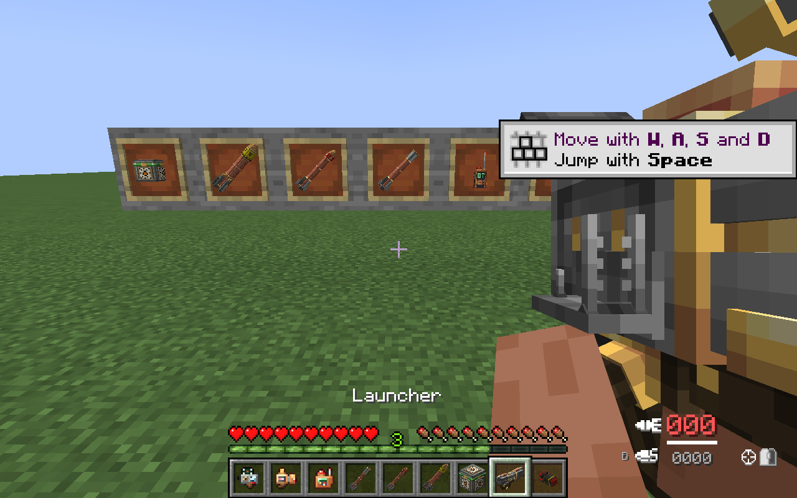
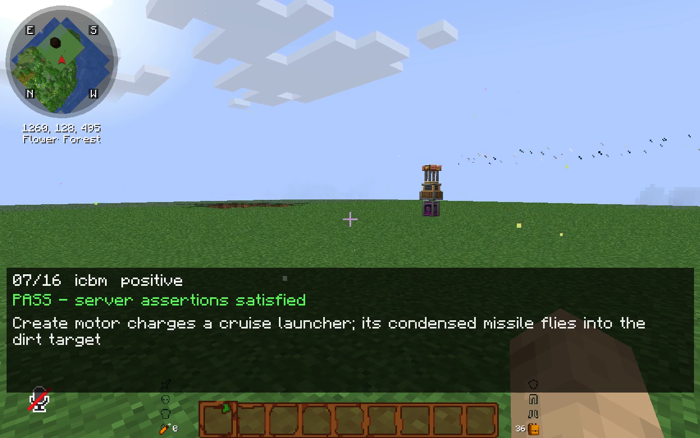
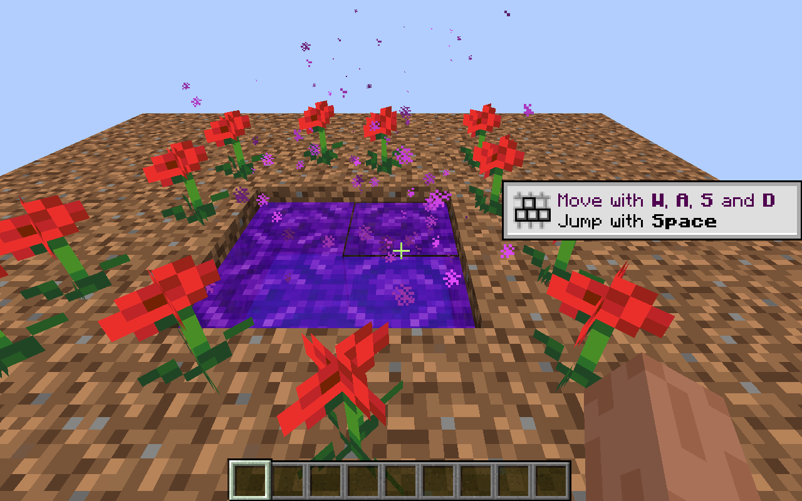
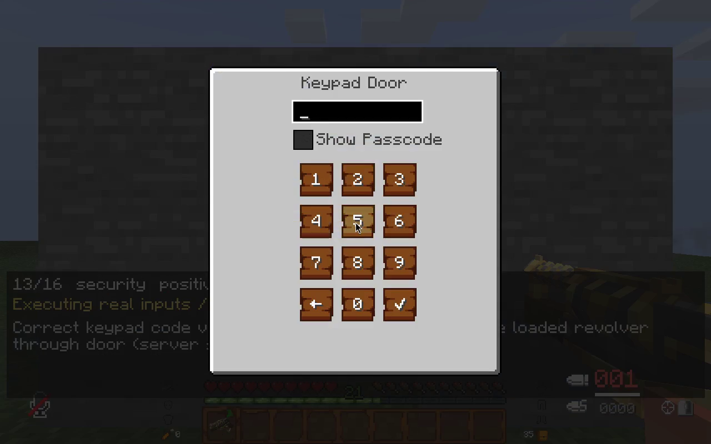

# Minecraft Fabric 1.20.1 — ports & projects

A directory of our Fabric 1.20.1 projects, with screenshots from real client/server test runs. These are **separate mods and source repositories**, not a one-click modpack. Most are unofficial ports or integrations built on other authors' work; see each project for attribution, licensing, build instructions and limitations.

## Projects

| Project | What it is | Source and licensing notes |
| --- | --- | --- |
| [Create: Gunsmithing](https://github.com/betizzel/create-gunsmithing-fabric) | Unofficial Fabric port of Create: Gunsmithing 1.4.4 | Upstream GPL-3 license file and conflicting original ARR metadata retained; depends on NTGL. |
| [NTGL](https://github.com/betizzel/ntgl-fabric) | Native Fabric port of NukaTeam Gun Library 3.1.2 | Upstream LGPL-2.1 declaration and file-specific notices retained. |
| [Create: ICBM](https://github.com/betizzel/create-icbm-fabric) | Unofficial Fabric 1.20.1 backport of Create: ICBM | CC BY-NC 4.0 code/art; separate MIT notices for identified upstream code. Noncommercial terms apply. |
| [Twilight Forest Unofficial](https://github.com/betizzel/twilightforest-fabric) | Fork of the existing unofficial Fabric 1.20.1 implementation | LGPL code; separately licensed noncommercial/share-alike assets. The fork's source is not proven identical to the tested published 1.4.7 binary. |
| [Villagers Reborn](https://github.com/betizzel/villagers-reborn-fabric) | Unofficial Fabric port of the Forge 1.20.1 release | Author's project listing declares MIT; artifact metadata says ARR. Separately reserved entity textures are omitted from Git and fetched from the hash-pinned official artifact when building. |
| [Fantasy Knights & Factions](https://github.com/betizzel/fantasy-factions-fabric) | Unofficial Fabric port of the Forge 1.20.1 release | Author's project listing declares MIT; artifact metadata says ARR. Separately reserved entity textures are omitted from Git and fetched from the hash-pinned official artifact when building. |
| [Create: Maglev](https://github.com/betizzel/create-maglev) | Our powered electric, bullet-train and maglev addon for Create and Create: New Age | Original addon under MIT; its dependencies retain their own licenses. |
| [SecurityCraft Fabric server fix](https://github.com/betizzel/securitycraft-fabric-server-fix) | Dedicated-server correction for the existing unofficial SecurityCraft Fabric V0.7 | MIT correction and build overlay over the published V0.7 artifact; **not a full official SecurityCraft port** or a reconstruction of all V0.7 source. |

Check each repository for the required versions and dependencies before installing. Gunsmithing requires NTGL; Maglev requires compatible Create and Create: New Age installations. These links do not imply that every combination or feature has been exhaustively tested, that a public release JAR is available, or that incompatible Forge/NeoForge JARs can be used on Fabric.

## Screenshots from testing

These images are from **isolated, disposable test worlds**, not a live player's world. The on-screen overlays identify recorded test scenarios; they are not a substitute for the underlying assertions or complete compatibility guarantees.

### Create: Maglev — powered guideway

A frame from the powered Maglev recording: the server starts the train's native schedule using Create: New Age-generated power.

### Villagers Reborn — dialogue

The real dialogue interface after choosing the Friendly interaction in a test world.

### Fantasy Factions — rival knights

A recorded observation of a knight and an evil knight during a native AI combat scenario.

### Gunsmithing — launcher model

A client rendering check with the launcher held in first person and the other items displayed behind it.

### Create: ICBM — powered launch

A recorded launcher test after a native server action activated the machinery; the scene shows the impact area and particle trail.

### Twilight Forest — portal

A real Twilight portal formed in a test world using the existing unofficial Fabric implementation.

### SecurityCraft — keypad door

The existing Fabric V0.7 keypad interface during the corrected mod's access-control integration test.

## Test scope and credits

The ports were exercised in native Fabric client/server scenarios, including positive and negative controls for dialogue, faction combat, firearms, missiles, Twilight portals and SecurityCraft access/cameras. Maglev has separate recorded train and save/reload checks. Some test setup or actions were driven by the native server and are labeled in the recordings; screenshots alone do not establish every behavior. Tests used software rendering; physical-GPU, shader and arbitrary modpack compatibility were not exhaustively verified.

Minecraft, Create, SecurityCraft, Twilight Forest, and the original mods and artwork belong to their respective authors. The screenshots document gameplay; they do not grant additional rights to the depicted mods or assets. Licensing differs by repository—there is no blanket license for all linked projects.
